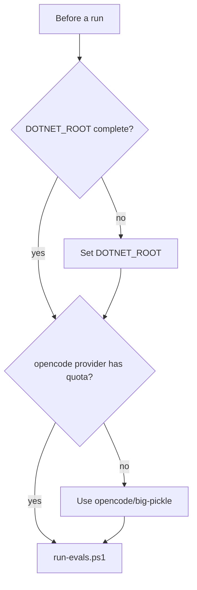

# Environment limits

These limits apply to the maintainer's Windows machine and the current agent versions. Check them before a run.

| Limit | Effect | Handling |
|---|---|---|
| `~/.codex/AGENTS.md` names `/dotnet-mutation-testing` | Codex baselines read `~/.agents/skills/dotnet-mutation-testing/SKILL.md` with `Get-Content`. `skills.config` hides discovery, not a direct read. | The harness sets `globalSkillUsed` and leaves the run out. The Codex `require-guards` baseline is not measurable while this instruction exists. `-Isolate` avoids it, but agents then need credentials from environment variables. |
| Global instruction files reach both modes | `~/.claude/CLAUDE.md` and `~/.codex/AGENTS.md` load in baselines. `--setting-sources` does not remove user `CLAUDE.md`. | Record this as a limit. Do not change the user's global files. |
| `DOTNET_ROOT` points to an incomplete dnvm folder | `dotnet test` aborts: the testhost finds no `host/fxr` version. | Set `DOTNET_ROOT` to `C:\Program Files\dotnet` for runs and grader tests. |
| GitHub Copilot quota in opencode | Copilot models return `You have exceeded your monthly quota`. | Use `opencode/big-pickle`. The harness records the quota error as `agentError`. |
| opencode run time | One opencode `require-guards` run used the full 40-minute timeout. | Use `-TimeoutMinutes 40` for mutation tasks. |
| Agent update dialogs | An interactive Codex update dialog can consume input. | Select `Skip`. Eval runs use `codex exec`, which shows no dialog. |
| `make` is not installed on the Windows machine | `make` targets fail locally. | Run the commands from the Makefile directly. CI has `make`. |



```powershell
$env:DOTNET_ROOT = 'C:\Program Files\dotnet'
pwsh ./evals/run-evals.ps1 -Skill dotnet-mutation-testing -Target codex -Mode without -DryRun
```

Related: [harness](harness.md), [results](results.md).
