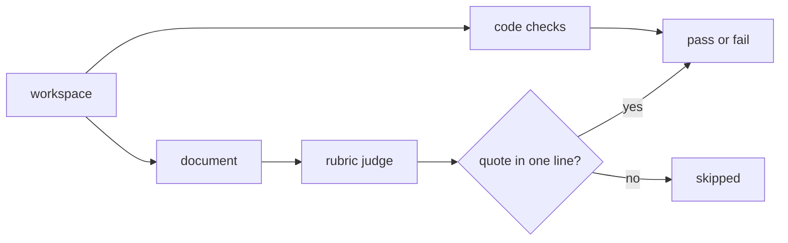

# Grader contract

A grader is `evals/<skill>/graders/<task>.ps1` with parameters `-Workspace` and `-OutDir`. It writes `grading.json` with checks. `passed` is `$true`, `$false`, or `$null` for a skipped check. The summary pairs checks by their text, so a changed text needs a regrade of old results.

```powershell
Import-Module (Join-Path $PSScriptRoot '../../lib/Grading.psm1') -Force
$checks = @()
$checks += New-Check 'The final tree builds and all tests pass' $finalOk "verdict: $($final.verdict)"
$checks += Invoke-Rubric -Workspace $Workspace -EvalDir (Split-Path $PSScriptRoot) -TaskId 'icedtasks-properties'
Write-Checks (Join-Path $OutDir 'grading.json') $checks
```

## Code-running graders

- Compute expected values by running code, not from constants. The `require-guards` grader builds and tests each mutant on the task tree and compares the agent's report with its own run.
- `Get-TestRunOutcome` gives the verdict. A compiler error in a `.fs`, `.fsi`, `.fsx`, or `.cs` file is `invalid`. A missing TRX, a restore or MSBuild error, or a non-zero exit with no failed test is `inconclusive`. A failed test is `detected`. A clean run with tests is `survived`.
- Outcomes are cached by outcome version, commit, patches, and test arguments. Inconclusive outcomes are not cached, and the grader throws.
- The final-tree check builds and tests a copy of the whole workspace. It passes when all tests pass with the baseline test count. When the final run is inconclusive, the grader throws only if HEAD is still the task commit, `src/` has no change, the uncommitted test change is intact, no other tracked file changed, and no untracked build input exists. Untracked build inputs are `global.json`, `nuget.config`, `Directory.*`, `paket.*`, project, solution, `.props`, `.targets`, and `.user` files outside `bin/`, `obj/`, and `.eval-results/`. Otherwise the check fails.
- `dotnet` runs in the repository root, because it selects the SDK from `global.json`.

## Rubric judge

- `rubricDocument` names the agent's document, and `rubric` holds `{id, question}` items. `yes` is the good answer.
- The judge sees only the questions and the document. `<skill>-eval` is replaced with `<skill>`. The default judge is Claude Code `haiku` with a JSON schema, no tools, no settings, and its own system prompt. `SKILL_EVAL_JUDGE` overrides it.
- A `yes` passes only when its quote is in one normalized line of the document. A `no` fails. A bad quote, a missing answer, or a judge failure skips the check. Each rubric check keeps the raw `answer` for agreement.
- Write one question per statement, about something one line can show. Do not tune questions to observed outputs.

## Grader tests

Each task has `evals/<skill>/tests/Grader.Tests.ps1` with a known-good and a known-bad workspace. A new grader rule needs a case that fails without the rule. Fast tests in `evals/tests/` run in CI with `make test-evals`. Grader tests need network, .NET 10, and a signed-in judge, so they run by hand.



Related: [harness](harness.md), [task design](task-design.md).
