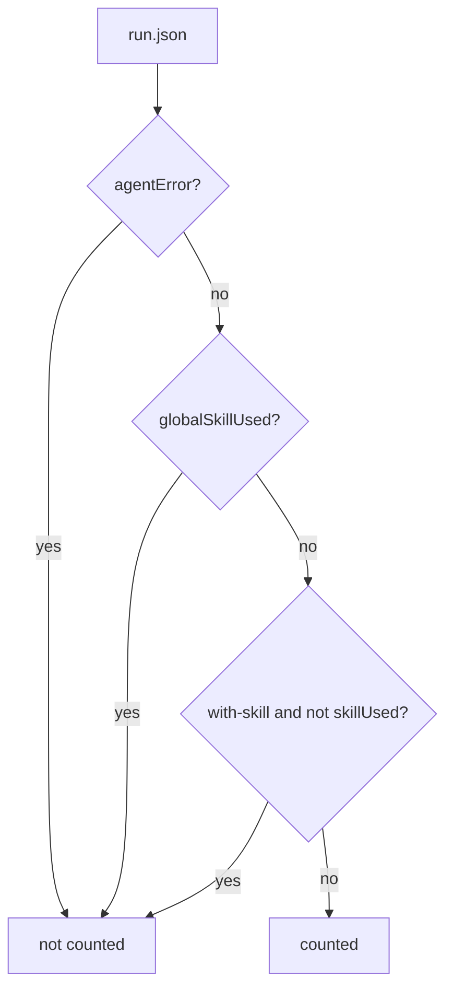

# Runner and isolation

## Runner

`run-evals.ps1` takes `-Skill`, `-Target agent[:model]`, `-Task`, `-Mode`, `-Runs`, `-TimeoutMinutes`, `-RunId`, `-Isolate`, and `-DryRun`. One process runs its agents one at a time. Parallel agents use one process per target with the same `-RunId`. Each run folder has a fixed name `<target>-<task>-<mode>-rNN`, and a run with a `run.json` is skipped, so a command can restart after an interruption. The summary reads every `run.json` under the result folder.

## Workspaces

- The runner keeps one full clone of each task repository under `<OutputRoot>/cache/repos/`. A blobless clone would fetch blobs lazily, so the cache is a full clone.
- Each workspace is a clone at the pinned commit in the temp folder. A workspace inside a checkout would inherit parent `global.json` and `Directory.*.props` files.
- `workingTreePatch` applies an uncommitted change. `files` copies task inputs.
- `TASK.md`, inputs, and the installed skill go into `.git/info/exclude`, so `git status` shows only agent changes.
- Clones use `core.autocrlf=false`, and `evals/.gitattributes` keeps `*.patch` files at LF, so patches apply on Windows.
- `run.json` records `dotnetSdk` from `dotnet --version` in the workspace.

## Skill isolation

| Agent | With skill | Baseline |
|---|---|---|
| Claude Code | `.claude/skills/<skill>-eval/` | `--disable-slash-commands` |
| Codex | `.agents/skills/<skill>-eval/` | `-c skills.config=[{path=...,enabled=false}]` for each matching global skill |
| opencode | both folders | `OPENCODE_CONFIG_CONTENT` denies matching skills, and `--pure` disables plugins |

Matching global skills are found by name and by `contaminationKeywords` in their descriptions. The runner and the rubric judge remove parent Claude Code session variables such as `CLAUDECODE`. `-Isolate` gives each run an empty home. Agents then need credentials from environment variables, such as `ANTHROPIC_API_KEY`, `CLAUDE_CODE_OAUTH_TOKEN`, or `CODEX_API_KEY`. Saved logins do not work.

The transcript decides `skillUsed` (the `-eval` copy loaded) and `globalSkillUsed` (a global copy loaded). Only a skill tool call or tool output with the `name:` frontmatter line counts. A baseline can still read a global `SKILL.md` directly. See [environment limits](environment-limits.md).

## Counted runs and metrics

A run counts when it has no `agentError`, did not load a global copy, and loaded `<skill>-eval` in with-skill mode. `agentError` comes from a provider error event, a Codex `turn.failed`, or a non-zero exit. A Codex `error` event that a `turn.completed` follows is a retried stream error. A timed-out run counts as a failed attempt.

Each run records seconds, tokens, cost (Claude and opencode only), turns, `failedBuilds`, and `failedTestRuns`. A `dotnet` build, test, run, fsi, publish, pack, or msbuild call is a failed build when its output has `error FS`, `error CS`, `error MSB`, `error NU`, or `Build FAILED`, or when a non-test call exits with an error. A `dotnet test` call that exits with an error and has none of these lines is a failed test run. Turn counts differ by agent, so compare modes within one target. Summary numbers use the invariant culture.



## Regrade and agreement

`grade-evals.ps1 -ResultDir` reruns graders and transcript metrics on saved runs. `rubric-agreement.ps1 -Repeat 3` judges counted runs that wrote the document and compares raw yes/no answers. Items without a judge answer are left out of the rate. A grader exception gives a skipped `Grader completed` check, so the run has no pass rate.

```powershell
pwsh ./evals/grade-evals.ps1 -ResultDir $env:TEMP/skill-evals/matrix1
```

Related: [grader contract](grader-contract.md), [results](results.md).
