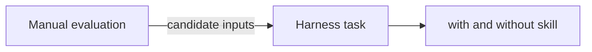

# Manual evaluations

`docs/evaluations/` holds evaluations in which an agent applies skills to a pinned public repository and a report records the evidence. They have no baseline, so they show what the skills produce, not what the skills add. The method is in [docs/evaluations/README.md](../../docs/evaluations/README.md).

| Evaluation | Skill revision | Targets and result |
|---|---|---|
| [2026-09-23](../../docs/evaluations/2026-09-23/README.md) | `0870cc1` | Fantomas workload (4 tests, 400 generated cases), IcedTasks cancellation mutant detected, FsToolkit `requireTrue` mutant detected, FsAutoComplete script options (3 passed, 2 skipped) |
| [FsAutoComplete research rerun](../../docs/evaluations/2026-09-23/fsautocomplete-research/system.md) | `0e4e2df` | Repository-wide catalog of 31 properties with a coverage matrix and an acceptance audit |
| [2026-09-24 test audit](../../docs/evaluations/2026-09-24-test-audit/README.md) | snapshot `dd3efc7` | Read-only audit of the executable examples: six checks retained, four marked for repair |
| [2026-10-12 harness](../../docs/evaluations/2026-10-12-eval-harness/README.md) | `59afa0b` | Harness results, see [results](results.md) |

Pinned repositories that tasks can reuse:

| Repository | Commit | SDK |
|---|---|---|
| FsToolkit.ErrorHandling | `d482e196cc3333e820355a0e412e01111944f3a7` | `global.json` 10.0.100, `latestMinor`; tests `net9.0` and `net8.0` |
| IcedTasks | `c51e9fc63fb0c78887f5c418b0530453a2b2cf80` | `global.json` 10.0.100 RC 1, `latestMinor`; tests `net10.0`, `net9.0`, `net8.0` |
| Fantomas | `4379df8c882f5377b2c83de19d86b6762458d0c1` | 11.0 RC `global.json` |
| FsAutoComplete | see [its report](../../docs/evaluations/2026-09-23/fsautocomplete.md) | see the report |

Rules for a manual evaluation: record skill and repository revisions, the request, commands, counts, and limits. Do not supply the expected conclusion. Keep mutants in a disposable copy. A focused test run does not establish repository-wide research coverage.



```text
git clone https://github.com/demystifyfp/FsToolkit.ErrorHandling.git
git -C FsToolkit.ErrorHandling checkout d482e196cc3333e820355a0e412e01111944f3a7
```

Related: [task design](task-design.md).
