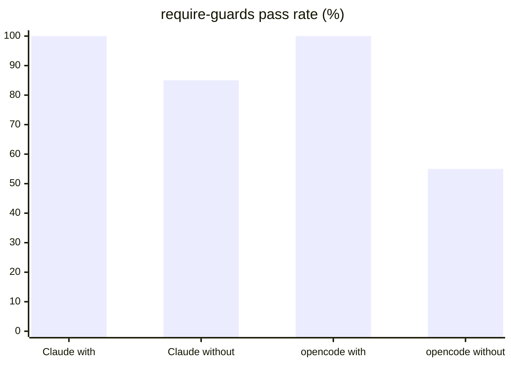

# Harness results

The current results come from skill revision `59afa0b`, with 2 runs per mode. Targets: `claude:sonnet`, `codex` (gpt-6-astra), and `opencode:opencode/big-pickle`. The full table is in [docs/evaluations/2026-10-12-eval-harness](../../docs/evaluations/2026-10-12-eval-harness/README.md).

| Target | Task | With skill | Without skill |
|---|---|---|---|
| Claude | `require-guards` | 100% | 85% |
| Codex | `require-guards` | 100% | not measurable |
| opencode | `require-guards` | 100% | 55% (one baseline timed out, the other passed all checks) |
| Claude | `icedtasks-properties` | 85% | 84% |
| Codex | `icedtasks-properties` | 95% | 100% |
| opencode | `icedtasks-properties` | 95% | 80% |

- `dotnet-mutation-testing` shows lift only for Claude. The Claude baselines missed the uncommitted-change and invalid-mutant facts.
- The opencode `require-guards` difference is not evidence of lift.
- `dotnet-review-inputs` shows no consistent improvement.
- The rubric judge gave the same answer in 3 grades for 69 of 72 items.
- Two runs per mode is a first sample.



```powershell
pwsh ./evals/rubric-agreement.ps1 -ResultDir <OutputRoot>/matrix1 -Repeat 3
```

Related: [environment limits](environment-limits.md), [task design](task-design.md).
