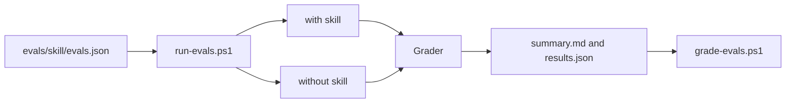

# Eval harness

The harness in `evals/` measures whether a skill changes agent results. It runs each task with the skill and without it on Claude Code, Codex, and opencode, then grades both workspaces with the same grader. The user-facing manual is [evals/README.md](../../evals/README.md).

- [harness.md](harness.md): runner, workspaces, skill isolation, effort metrics, regrade, and agreement.
- [grader-contract.md](grader-contract.md): three-state checks, code-running graders, and the rubric judge.
- [task-design.md](task-design.md): how to make a task that discriminates, and the current tasks.
- [results.md](results.md): current harness results.
- [manual-evaluations.md](manual-evaluations.md): evaluations in `docs/evaluations/`.
- [environment-limits.md](environment-limits.md): machine and agent limits found in runs.



```powershell
pwsh ./evals/run-evals.ps1 -Skill dotnet-review-inputs -Target claude:sonnet,codex,opencode:opencode/big-pickle -Runs 2
```
