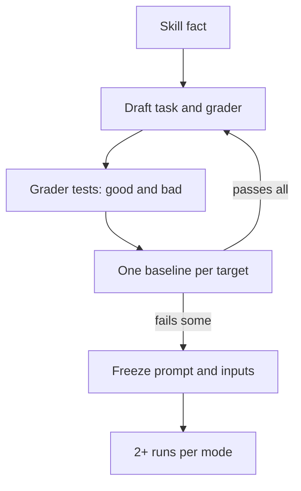

# Task design

A task must depend on a skill fact that a careful agent does not find without the skill. Run one baseline per target before the matrix. If the baseline passes every check, change the task. After that, freeze the prompt and inputs: a grader fix can be regraded, but a prompt change needs new runs. Use pinned public repositories from `docs/evaluations/` as inputs, because small made-up tasks often do not reproduce real difficulty.

## Current tasks

| Skill | Task | Repository | Skill facts under test |
|---|---|---|---|
| `dotnet-mutation-testing` | `require-guards` | FsToolkit.ErrorHandling `d482e196` | Include uncommitted changes in the mutant snapshot (M2 is caught only by an uncommitted test). A compiler error is an invalid mutant, not a detection (M3, FS0064). M4 (`Seq.length xs = 0`) survives the current tests. It is not equivalent for an infinite or throwing sequence. |
| `dotnet-review-inputs` | `icedtasks-properties` | IcedTasks `c51e9fc6` | The `parallelism` properties take `unit`, use fixed `yieldMany` counts, and `fsCheckConfig` sets `maxTest = 10` under CI. Scheduling is the only variation, so seed replay cannot reproduce a failure. |

`require-guards` discriminates for Claude. `icedtasks-properties` does not discriminate for strong agents: Claude and Codex pass most items without the skill. It needs a harder task. See the [eval coverage plan](../plans/eval-coverage.md).

```json
{
  "id": "require-guards",
  "repository": { "url": "https://github.com/demystifyfp/FsToolkit.ErrorHandling.git", "commit": "d482e196cc3333e820355a0e412e01111944f3a7" },
  "workingTreePatch": "inputs/working-tree.patch",
  "files": ["inputs/mutants"],
  "grader": "graders/require-guards.ps1"
}
```



Related: [grader contract](grader-contract.md), [results](results.md).
