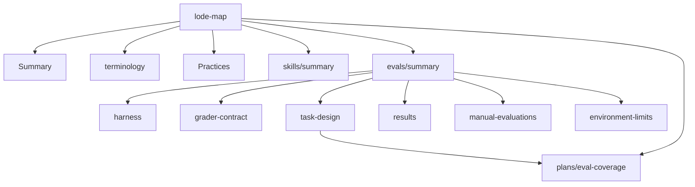

# Lode index

- [summary.md](summary.md): repository snapshot.
- [terminology.md](terminology.md): shared terms.
- [practices.md](practices.md): skill rules, checks, and evaluation rules.
- [skills/summary.md](skills/summary.md): the eleven skills, their purpose, and their evaluation evidence.
- [evals/summary.md](evals/summary.md): eval harness index.
  - [evals/harness.md](evals/harness.md): runner, workspaces, isolation, metrics, regrade, agreement.
  - [evals/grader-contract.md](evals/grader-contract.md): checks, code-running graders, rubric judge, grader tests.
  - [evals/task-design.md](evals/task-design.md): discriminating tasks and the current tasks.
  - [evals/results.md](evals/results.md): current harness results.
  - [evals/manual-evaluations.md](evals/manual-evaluations.md): `docs/evaluations/` and pinned repositories.
  - [evals/environment-limits.md](evals/environment-limits.md): machine and agent limits.
- [plans/eval-coverage.md](plans/eval-coverage.md): ranked tasks for skills without harness tasks.
- `tmp/`: git-ignored session notes and handovers.
- Outside the Lode: [evals/README.md](../evals/README.md), [docs/evaluations/README.md](../docs/evaluations/README.md), [AGENTS.md](../AGENTS.md).



```powershell
Get-Content lode/lode-map.md, lode/terminology.md, lode/summary.md
```
