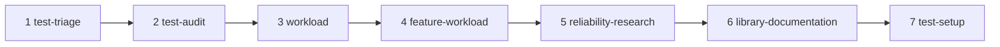

# Eval coverage plan

Two skills have harness tasks. The other skills need tasks, ranked by the expected value of a with/without comparison and by how easily a grader can run code. Each task follows [task design](../evals/task-design.md): pinned repository, a skill fact, grader tests, and a failing baseline before the matrix.

| Rank | Skill | Task idea | Grader |
|---|---|---|---|
| 1 | `dotnet-test-triage` | Give a failed FsCheck or Expecto run with a counterexample and logs, for example an IcedTasks test with a timing-dependent failure. Ask for a root cause and the next check. | Code: rerun with the reported seed or command. Rubric: separates input replay from scheduling, and names unexercised tests. |
| 2 | `dotnet-test-audit` | Audit a test file with known redundant, tautological, and coupled checks in a pinned repository. | Code: delete the tests marked removable, run mutants, and confirm no detection is lost. Rubric for the keep/repair reasons. |
| 3 | `dotnet-workload` | Give a property catalog entry and ask for a workload in the target repository. | Code: the workload builds, passes, and fails against a seeded mutant. Reach check through a marker. |
| 4 | `dotnet-feature-workload` | Ask for a workload for one feature, such as cancellation in IcedTasks. | Code: same as rank 3, plus a check that the SDK and test framework did not change. |
| 5 | `dotnet-reliability-research` | Ask for a property catalog of one bounded subsystem. | Rubric against an independent inventory, plus citation checks. Repository-wide scope needs a separate, larger task. |
| 6 | `dotnet-library-documentation` | Ask a version-specific question, such as FsCheck 3.4.0 `Replay.Size` behavior. | Code: a probe script confirms the answer against the installed version. |
| 7 | `dotnet-test-setup` | Ask for a Testcontainers-backed fixture in a repository that already uses one service. | Code: tests start and stop the service. Needs Docker in the eval environment. |

Also open:

- `icedtasks-properties` needs a harder task. Claude and Codex pass most rubric items without `dotnet-review-inputs`. A candidate is a generator with filtering, size limits, or a custom shrinker that hides a region of inputs, where the grader checks the excluded region by running a probe.
- The Codex `require-guards` baseline cannot be measured while `~/.codex/AGENTS.md` names the skill. Measure it with `-Isolate` and an API key, or on a machine without that instruction. See [environment limits](../evals/environment-limits.md).
- Results use 2 runs per mode. Use 3 or more runs before a skill change depends on a difference.
- `dotnet-test-setup-k8s` and `dotnet-skills-feedback` have no planned task.



After a task has its `evals/<skill>/evals.json` and grader tests, run its baselines first:

```powershell
pwsh ./evals/run-evals.ps1 -Skill dotnet-test-triage -Target claude:sonnet,codex,opencode:opencode/big-pickle -Mode without -Runs 1
```
