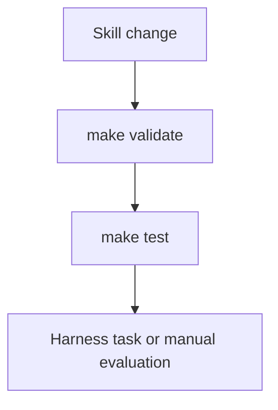

# Practices

## Skills

- Each skill is a root-level directory whose `name` frontmatter equals the directory name, with a nonempty `description` and a top-level heading.
- A skill is self-contained. References and assets stay inside its directory.
- Instructions cover C#, F#, .NET libraries, and runtime contracts. They contain no repository history.
- Skills preserve the target repository's SDK, package versions, language, test framework, and runner.
- Skills distinguish input replay from scheduling control.
- Merge automation sets `metadata.version` and `CHANGELOG.md` for PRs labeled `changelog - breaking` or `changelog - non-breaking`. Do not edit them by hand.
- Apache-2.0 attribution and adaptation notices live in `LICENSE` and `NOTICE`, not in skill instructions.

## Checks

| Command | Checks |
|---|---|
| `make validate` | `scripts/validate-skills.py`: frontmatter and headings of `*/SKILL.md` |
| `make test` | `scripts/verify-examples.ps1`: C# and F# examples in `dotnet-feature-workload/assets/examples` pass and their deliberate defects fail |
| `make test-evals` | fast harness tests: metrics, rubric, verdict rules |
| `make validate-links` | lychee over all Markdown, with exclusions in `lychee.toml` |
| `make validate-changelog` | changelog structure |

CI runs validate, test, test-evals, typos, and lychee on Ubuntu, and the examples on Windows. The Lode has no `SKILL.md` and no project, so the skill and example checks ignore it. Lychee and typos check its Markdown.

## Evaluation

- Use behavioral evaluation for substantial skill changes. Do not assert natural-language wording in tests. Rubric checks judge meaning with a quoted line instead.
- Repository-wide research keeps its scope in evaluator assignments, and its inventory is audited against projects, entry points, and state owners.
- Commits follow conventional commit messages.

See [eval design](evals/task-design.md) and the [grader contract](evals/grader-contract.md).

