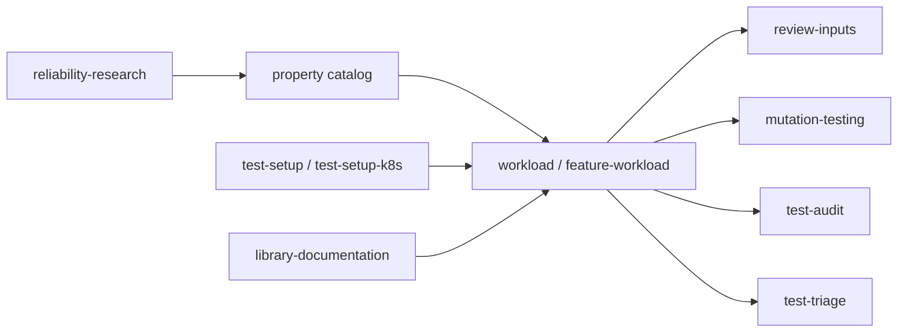

# Skill catalog

Each skill is a root-level directory. The table gives its purpose and its current evaluation evidence. See the [eval coverage plan](../plans/eval-coverage.md) for missing evidence.

| Skill | Purpose | Evaluation evidence |
|---|---|---|
| [`dotnet-reliability-research`](../../dotnet-reliability-research/SKILL.md) | Analyze a system and produce an evidence-backed property catalog and suitable test methods | Manual: Fantomas, FsToolkit, FsAutoComplete, and the repository-wide FsAutoComplete rerun |
| [`dotnet-review-inputs`](../../dotnet-review-inputs/SKILL.md) | Review FsCheck, Hedgehog, and custom generators for state-space limits, read-only | Harness task `icedtasks-properties`; manual: Fantomas |
| [`dotnet-feature-workload`](../../dotnet-feature-workload/SKILL.md) | Build or reuse a focused workload for one feature | Manual: Fantomas, IcedTasks; executable examples |
| [`dotnet-workload`](../../dotnet-workload/SKILL.md) | Implement properties from an existing catalog | Manual: FsToolkit |
| [`dotnet-mutation-testing`](../../dotnet-mutation-testing/SKILL.md) | Check whether tests detect realistic defects with Stryker.NET or isolated manual mutants | Harness task `require-guards`; manual: IcedTasks, FsToolkit |
| [`dotnet-test-audit`](../../dotnet-test-audit/SKILL.md) | Audit tests for regression value, redundancy, and coupling | Manual: audit of the executable examples |
| [`dotnet-test-triage`](../../dotnet-test-triage/SKILL.md) | Investigate failed, hung, flaky, or unexercised tests from runtime evidence | Manual: IcedTasks, FsAutoComplete |
| [`dotnet-library-documentation`](../../dotnet-library-documentation/SKILL.md) | Verify version-specific APIs and runtime contracts | Manual: FsAutoComplete |
| [`dotnet-test-setup`](../../dotnet-test-setup/SKILL.md) | Prepare local hosts and real dependencies with Testcontainers, Aspire, or Compose | Manual: FsAutoComplete fixture selection only |
| [`dotnet-test-setup-k8s`](../../dotnet-test-setup-k8s/SKILL.md) | Adapt existing Kubernetes manifests for scoped tests | None |
| [`dotnet-skills-feedback`](../../dotnet-skills-feedback/SKILL.md) | Prepare a reviewable bug report for this repository, without submission | None |

The skills form one workflow. Research produces a catalog. Workload skills implement it. Review, mutation, and audit skills measure the tests. Triage interprets failures.



Invoke a skill by name:

```text
/dotnet-mutation-testing Check whether the F# parser properties detect realistic boundary defects.
```

Related: [manual evaluations](../evals/manual-evaluations.md), [harness results](../evals/results.md).
