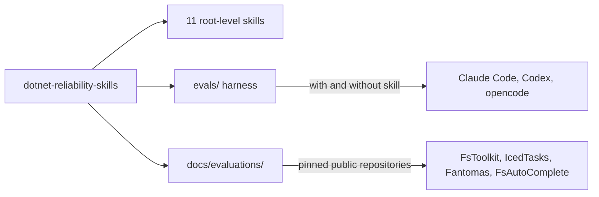

# Repository snapshot

`dotnet-reliability-skills` is a collection of eleven agent skills for C# and F# reliability work: property and workload tests, mutation testing, generator review, test audits, failure triage, environment setup, and library verification. Each skill is a root-level directory with a `SKILL.md` and optional `references/` and `assets/`, and it must work when installed alone. The [eval harness](evals/summary.md) in `evals/` measures whether a skill changes agent results by running each task with and without the skill on Claude Code, Codex, and opencode. Manual evaluations in `docs/evaluations/` apply the skills to pinned public repositories. Two skills have harness tasks, and the others are ranked in the [eval coverage plan](plans/eval-coverage.md). See the [skill catalog](skills/summary.md), [terminology](terminology.md), and [practices](practices.md).



Skill entry-point metadata:

```yaml
name: dotnet-mutation-testing
description: Evaluate whether C# or F# reliability checks detect realistic source defects. Use Stryker.NET where supported or isolated manual mutants, with a green baseline and per-property failure evidence.
```
