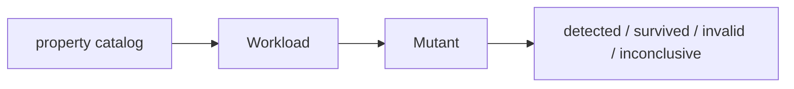

# Terminology

- skill - a root-level directory with `SKILL.md` that an agent loads for one kind of task.
- property - an observable contract that a test or workload checks, such as "requireTrue returns Ok only for true".
- property catalog - an evidence-backed list of properties from `dotnet-reliability-research`.
- workload - test code that drives production calls and checks properties, often with generated inputs.
- reach observation - evidence that a workload actually executed the code path under test.
- mutant - one deliberate production change used to check whether tests detect a defect.
- detected / survived / invalid / inconclusive - mutant verdicts: a test failed, all tests passed, the build failed with a compiler error, or infrastructure prevented a verdict.
- input replay - repeating generated inputs from a seed. It does not control thread scheduling.
- scheduling control - controlling thread interleavings, for example with Coyote. Distinct from input replay.
- eval task - one harness task: a pinned repository, a prompt, optional inputs, and a grader.
- baseline - a harness run without the skill.
- `<skill>-eval` - the install name of the skill in a with-skill workspace.
- global copy - a skill installed in the user's home directories, such as `~/.agents/skills/`.
- grader - a PowerShell script that writes three-state checks for one workspace.
- check - one grader result: `passed` is true, false, or null (skipped).
- rubric judge - a separate model that answers yes/no rubric items with a quote from the agent's document.
- agreement rate - the share of rubric items with the same judge answer in repeated grades.
- counted run - a run that the summary includes: no agent error, no global copy, and a loaded skill in with-skill mode.

See [practices](practices.md) and the [harness](evals/harness.md).



```powershell
pwsh ./evals/run-evals.ps1 -Skill dotnet-mutation-testing -Target claude:sonnet -Runs 2
```
